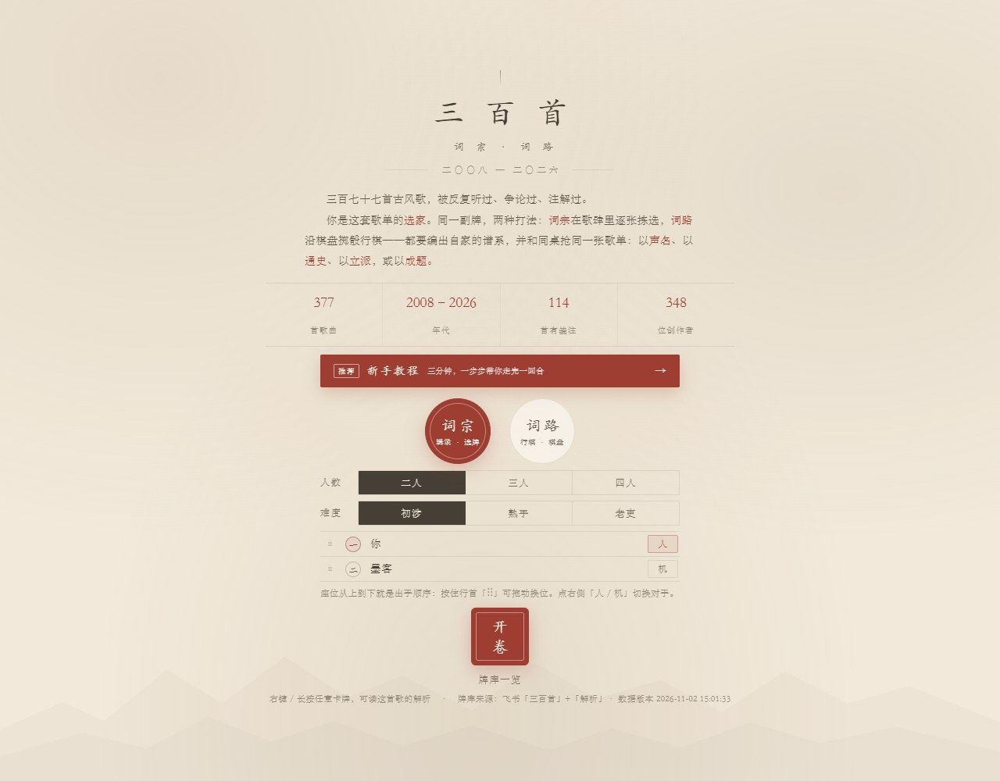
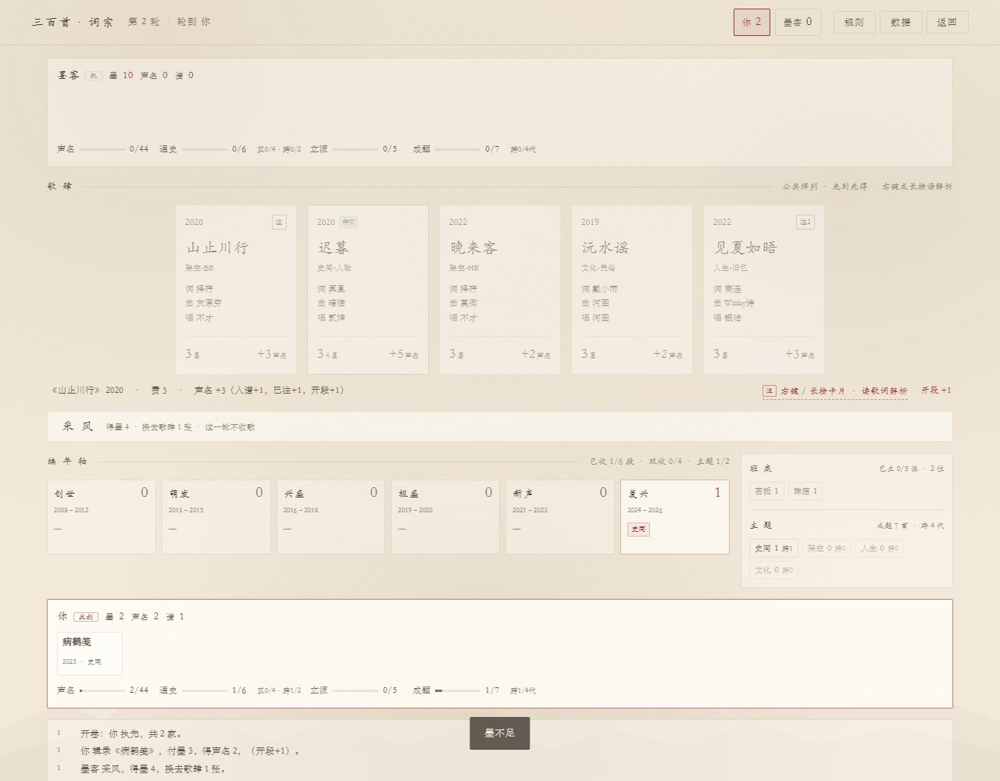
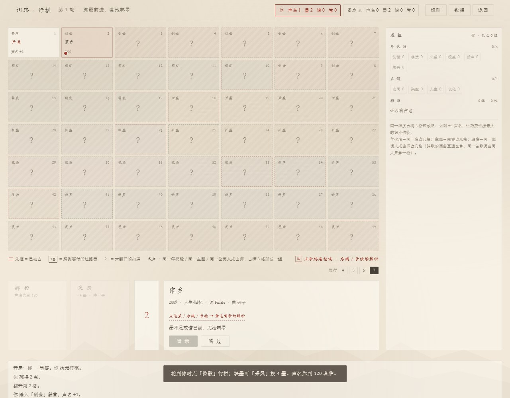

# 三百首 · 词宗 / 词路

用 **377 首中文古风歌曲（2008–2026）** 做牌库的双玩法桌游。纯前端、零依赖、断网可玩——双击 `index.html` 即可开局。

一句话：**同一副牌，两种打法**。一种在歌肆里逐张拣选，一种沿棋盘掷骰行棋；都要编出自家的谱系，先走通四条终点线之一的人赢。



## 玩法一览

| | 词宗（辑录） | 词路（行棋） |
|---|---|---|
| 拿到歌的方式 | 从公共歌肆（5–7 张）里挑 | 掷骰前进，落在哪格拿哪首 |
| 核心决策 | 四条终点线怎么配、墨怎么省 | 买不买、要不要采风、占地扎不扎堆 |
| 互动 | 抢同一张牌 | 踩到别人地盘付过路费 |
| 节奏 | 约 10–12 轮 | 声名先到 120；约 96 / 150 / 116 手 |
| 适合 | 想算、想规划 | 想逛、赌点运气 |

两套都支持 **2–4 人**：人机对战、多人同屏热座、人机混编；座位直接拖动改出手顺序，后手按位次拿补偿。

### 四条终点线（任一达成即胜）

| 线 | 条件（二人 / 三人 / 四人） | 打法 |
|---|---|---|
| **声名** | 累计声名 ≥ **44 / 44 / 43** | 挑高声名的牌，稳扎稳打 |
| **通史** | 六个年代各至少 1 张，其中 4 段各有 2 张；**全谱**共跨 **2 / 3 / 3** 个主题（不是只看那 4 段） | 按年代铺开，抢年代空位 |
| **立派** | 立 **5** 派：同一位词人或曲师**每 2 首算 1 派**；二人局另要求谱中至少 11 首（某位创作者已有 3 首可免） | 死磕同几位创作者 |
| **成题** | 同一主题 **7 / 7 / 8** 首，且跨 **4 / 5 / 4** 个年代 | 按主题横向收束，一类到底 |

四线同时摆着不是为了让你选一条，而是让「哪条最快」每局都在变。

### 一张牌的两面

- **费用**：基础 3 墨；**知音**（与谱中某张共享词/曲/编/唱/调校，每位 −1，最多 −2）、**同流**（与谱中最多的主题相同，−1）可减，最低 1 墨。
- **声名**：入谱 +1；特别篇/中V 各 +1；**已注**（有解析）+1；**知音** +1（共享 ≥2 位再 +1）；**开段**（该年代首次落子）+1；**同流成对**（同主题凑满 2/4/6 张）+2。

所以「顺着自己的班底往下收」比乱抓便宜得多——这是整套牌的经济核心。

## 界面

词宗：左边歌肆、下方编年轴，右侧是班底/主题看板（不用自己记「还差谁」）。



词路：49 格一条龙、开局全部扣着、走到才翻开；右侧是成组看板。



## 快速开始

```bash
git clone https://github.com/tjuchq/GF300.git
cd GF300
```

- **直接玩**：双击 `index.html`（`data/cards.js` 用 `<script>` 引入，`file://` 协议也能跑）
- **起个本地服务**（可选，便于改代码后热刷新）：

```bash
python -m http.server 8899
# 打开 http://localhost:8899/index.html
```

无需安装任何依赖，不需要 Node、不需要构建。

## 数据

牌库来自两张飞书多维表格：**「三百首」377 首**（歌名、年份、类型、历史主体、词曲编唱、声库、批次、平台、解析链接）与**「解析」278 条**（解读人、平台、原文链接）。

- 每张牌的**全部字段**都会参与机制或档案展示；右键 / 长按卡牌可看完整档案与解析
- **解析只存标题、作者、平台与原文链接，不转载正文**
- 字段做了别名容错：上游改列名不会让构建脚本崩，新增的未知列会原样保留在 `extra` 里

构建产物：`data/cards.json`（给程序读）与 `data/cards.js`（给网页读）。

### 数据怎么更新

表里加歌、补解析、改字段之后，**不需要动任何游戏代码**：

```bash
# 方式一：从飞书现拉再重建（需本机装好并登录 lark-cli）
python tools/update.py --from-feishu

# 方式二：拿已有导出重建
python tools/update.py --songs songs.ndjson --parses parses.ndjson
```

Windows 上也可以直接双击 `更新数据.bat`（纯 ASCII 批处理，不会出现中文乱码被当成命令的问题）。

> **表 ID 不进仓库。** 复制 `feishu.example.json` 为 `feishu.json` 并填入 `baseToken` 与两张表的 `tableId`（或设 `SB_BASE_TOKEN` / `SB_TABLE_SONGS` / `SB_TABLE_PARSES`）。`feishu.json` 已在 `.gitignore` 里。

## 目录结构

```
├─ index.html              入口（双击即玩）
├─ css/style.css           宣纸、墨、朱印；纯 CSS，无位图
├─ js/
│   ├─ engine.js           词宗规则引擎（纯逻辑，可被 Node 直接调用）
│   ├─ ai.js               墨客 AI（定主线 → 逐牌评分 → 出手或采风）
│   ├─ board.js            词路：棋盘、掷骰、占地、成组、机会/命运
│   ├─ hot.js              教程用热度表（榜单 × 解析数）
│   └─ ui.js               界面与交互
├─ data/
│   ├─ cards.json / .js    牌库（构建产物）
│   └─ raw/                构建用的原始导出（离线重建用）
├─ tools/
│   ├─ update.py           启动器（自动找 lark-cli 与 node）
│   ├─ build_cards.py      数据构建：NDJSON → cards.json / cards.js
│   ├─ simulate.js         平衡性模拟：AI 互搏，统计四条线胜率
│   ├─ sim_board.js        旧命令兼容层，转调 balance.js board
│   ├─ erd.js              达成轮次期望：每条线单独打，看「几轮能成」
│   ├─ balance.js          配平：四线胜率、座位补偿、三档策略矩阵
│   ├─ probe.js / tune.js / auto.js / scan.js / inkstat.js   旧版调参工具
├─ docs/                   README 用的界面截图
└─ 说明.md                 详细文档（玩法、平衡数据、设计取舍、已知限制）
```

## 平衡是怎么调的（给想改数值的人）

只看四条线的**胜率**调参数是打地鼠——四线共享 100% 份额，把 A 调难，B 的胜率自动涨。所以改用**达成轮次期望（ERD）**：让 AI 只盯一条线打，记录「几轮能成」，失败按「谱打满 + 8」计入。四线期望越接近，实际难度就越接近。

```bash
node tools/erd.js 2 200          # 二人局，四线期望轮次
node tools/simulate.js 800 3     # 三人局 800 局，四条线胜率 + 座位胜率
node tools/balance.js board 2 1500 normal   # 二人局棋盘，目标 120
```

定稿数值、掉过的坑（立派 4→5 派的断崖、成题靠跨代分档、墨要按人数分档）都写在 `说明.md` 的「4.4」里。

当前实测（每档 2000 局，墨客「熟手」档）：

| 人数 | 声名 / 通史 / 立派 / 成题 | 平均轮次 |
|---|---|---|
| 2 人 | 23.1 / 27.0 / 25.2 / 24.6 % | 12.0 |
| 3 人 | 24.2 / 23.0 / 25.6 / 27.2 % | 10.4 |
| 4 人 | 24.5 / 22.6 / 27.7 / 25.2 % | 9.9 |

四线全部落在 **22%–28%** 内。座位胜率、三档策略矩阵见 `说明.md`。

## 已知限制

- 单机游戏，没有联网对战；多人是同一台机器轮流（热座）
- AI 是启发式评分，不做多步前瞻
- 四线落在 22%–28%，已尽量贴近 25%
- 棋局运气成分大；门槛 120 由无界面模拟估算，真人打会比模拟慢一些

## 许可与版权

- **代码**（`js/`、`css/`、`tools/`、`index.html`）以 [MIT](LICENSE) 授权，随意取用。
- **歌曲元数据**来自公开信息与作者整理的飞书表，仅供学习交流；**解析条目只存标题、作者与原文链接，正文版权归各原作者**。
- 若你是其中某首歌/某篇解析的权利人且不希望被收录，开个 issue，会立刻移除。

---

数据构建于 2026-11 · 牌库 377 首 / 解析 278 条
